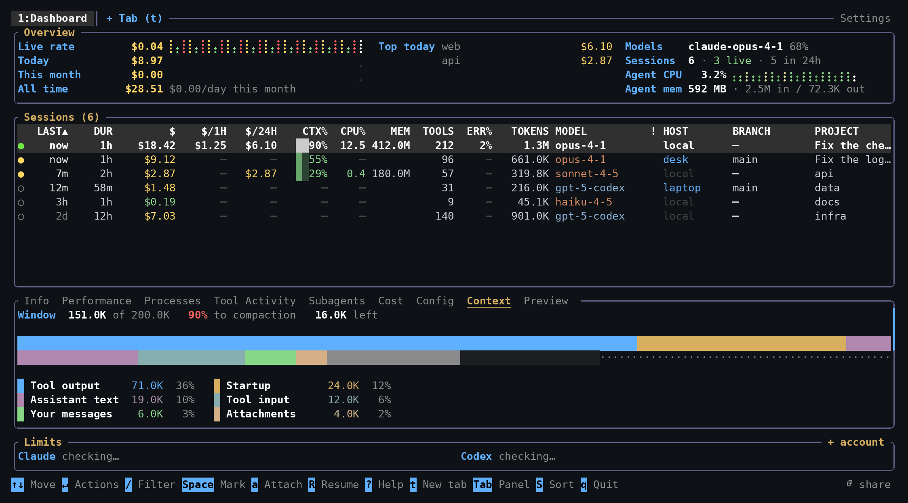
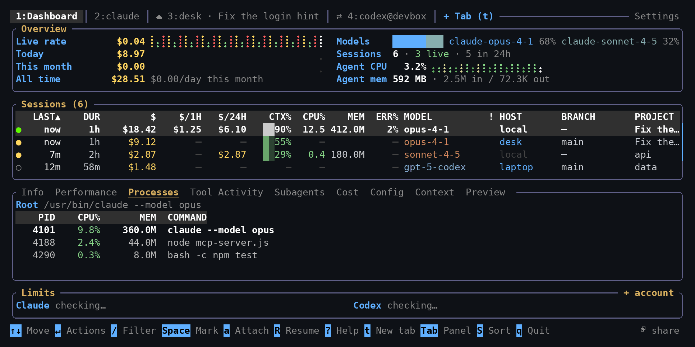
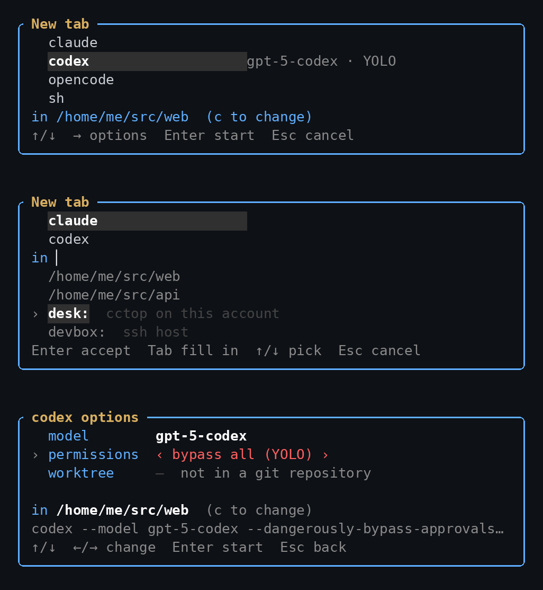
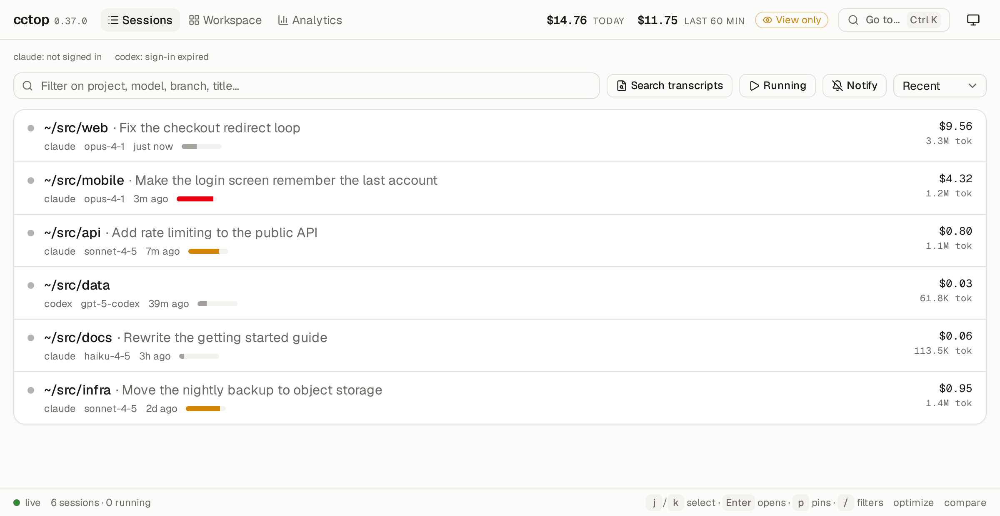
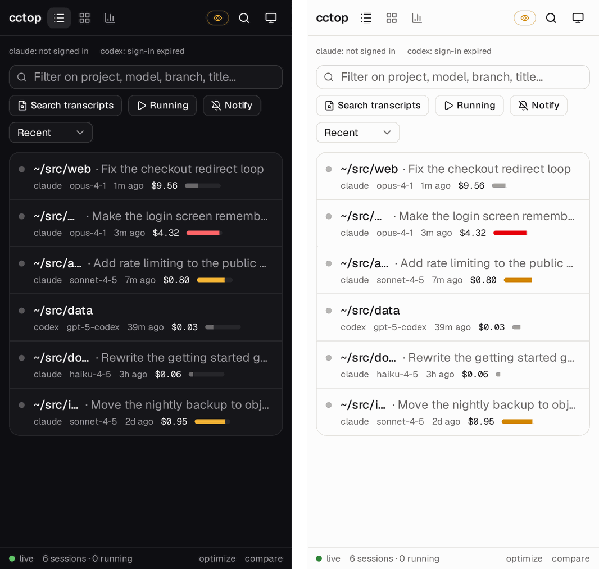
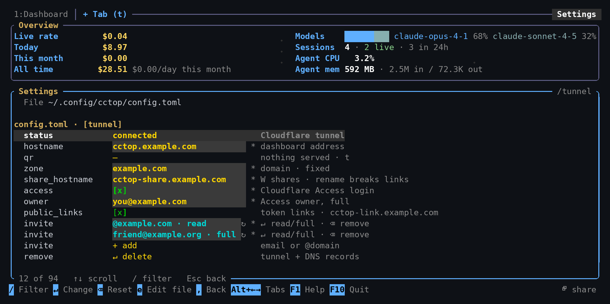
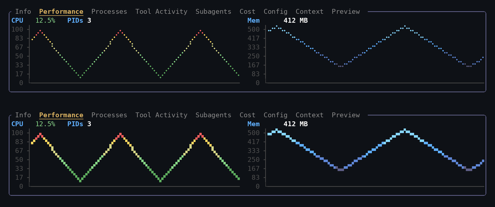
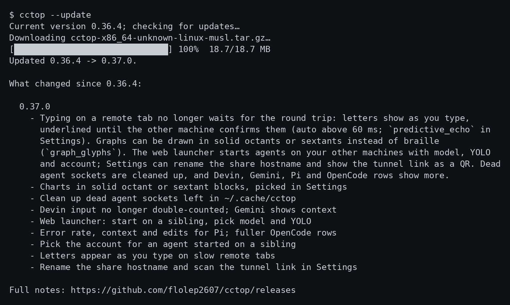

# cctop

[](https://crates.io/crates/cctop)
[](https://github.com/flolep2607/cctop/actions/workflows/ci.yml)
[](#install)
[](LICENSE)

**htop for your AI coding agents.** One terminal screen listing every Claude
Code, Codex, Cursor, Devin, Gemini CLI, Mistral Vibe, OpenCode, Pi and Windsurf
session on your machine, and on your other machines: what each is doing, what it has cost,
and which one is waiting on you. You can open any of them in a tab and type
into it.

> **Quick start:** install with the one line under [Install](#install), then
> run `cctop`. Nothing to configure first.



<sub>Every screenshot on this page is cctop drawing made-up sessions. Want it
moving? [A recording](docs/assets/demo.gif), or
[the same in a terminal](docs/assets/demo.cast) with `asciinema play`.</sub>

It reads what the agents already write to disk, so it sees sessions it did not
start, including ones that ended weeks ago.

## Install

Linux only, WSL included. There is no macOS or Windows build.

```bash
curl -fsSL https://raw.githubusercontent.com/flolep2607/cctop/main/install.sh | sh
```

The script picks the x86_64 or aarch64 release, checks its checksum and puts
one static binary in `/usr/local/bin` (or `~/.local/bin`). It then offers to
install `sshfs`, which only `cctop sandbox` needs; Enter says no.

<details>
<summary>Other ways to install</summary>

From the release archive, by hand (swap in `aarch64` on ARM):

```bash
d=$(mktemp -d)
curl -fsSL https://github.com/flolep2607/cctop/releases/latest/download/cctop-x86_64-unknown-linux-musl.tar.gz | tar xz -C "$d"
sudo install -m755 "$d/cctop" /usr/local/bin/cctop && rm -rf "$d"
```

With cargo:

```bash
cargo binstall cctop           # the release binary
cargo install cctop --locked   # compile it; needs Rust 1.89 or newer
```

### From source

```bash
git clone https://github.com/flolep2607/cctop && cd cctop
cargo build --release          # binary in target/release/cctop
```

Checksums and updating (`cctop --update`) are in
[Installing cctop](docs/install.md).

</details>

## First steps

### 1. Run it

```bash
cctop
```

It finds your sessions, prices them and draws the table. On its first run it
also installs its hooks into every agent it finds a config directory for, so
Claude Code, Codex, Gemini CLI, Cursor and OpenCode report their state as it
happens instead of cctop inferring it from disk. `cctop --hooks-status` shows
what is installed, and `cctop doctor` says what is wrong when something looks
off.

The keys to start with:

| Key | |
|---|---|
| `↑` `↓` | move between sessions |
| `Enter` | everything you can do to the selected session, in one menu |
| `/` | filter on anything in a row |
| `R` | resume the selected session in a tab of its own |
| `s` | type a line into a running agent |
| `t` | new tab: an agent or a shell, here or on another machine |
| `Alt+b` | jump to the tab that is waiting on you |
| `F12` or `Alt+1` | back to the dashboard; the tab keeps running |
| `,` | settings |
| `?` | every key |
| `q` | quit |

Agents in cctop's tabs run in its built-in multiplexer, so they keep running
after you quit and are back in their tabs next time.

### 2. Use it from your phone

Press `B` in the dashboard for the browser panel, then `t` to serve the same
table, and a page per session, over a public Cloudflare link (`l` serves it on
this machine only). `c` shows the link as a QR code to scan. Or run
`cctop serve --tunnel` directly. Whoever holds the link can drive your agents;
a second, read-only link is printed beside it.

For a link that stays the same across runs, connect your own free Cloudflare
account once (it needs a domain whose DNS is on Cloudflare):

```bash
cctop tunnel setup --browser
```

Details, Cloudflare Access logins and invites: [In a browser](docs/serve.md).

### 3. Several machines, one table

Run `cctop tunnel setup --browser` on each machine, against the same Cloudflare
account, and keep each one serving on its tunnel (`B` then `t`, or
`cctop serve --tunnel`). Each then shows the others' sessions in its table,
with the machine's name on the row. No ssh route is needed. `R` opens a remote
session in a tab here, and `t` starts a new agent on any of them.

Over ssh instead: `cctop --host devbox` adds another machine's sessions,
read-only.

## Features

### Every machine, one table



Machines connected to one Cloudflare account find each other: their sessions
are rows here, with the machine in the `HOST` column. `R` on one of them opens
it in a tab on this screen, and `t` starts a new agent or a shell over there.
A tab on another machine says how it gets there: `☁` through a sibling's
tunnel, `⇄` over ssh.

A remote tab is built for a link that is slow or flaky:

- **Local echo.** Each key would wait a round trip through Cloudflare (around
  120 ms) before its letter appeared. cctop draws the letter at once,
  underlined, and lets the far side's echo confirm it, as mosh does.
  `predictive_echo` in settings: `auto` (on above 60 ms), `always` or `off`.
- **Resume on drop.** When the connection drops (the tunnel moves, the network
  changes) the tab gets back to the same terminal and is sent what it missed.
  A drop shorter than two seconds shows nothing at all.

### A new tab, anywhere, set up the way you want

<p align="center">
  
</p>

`t` (or `Alt+n`) lists the agents installed here and a shell. `c` changes
where it starts: a directory here, a machine on your Cloudflare account, or an
ssh host. `→` opens the agent's options before it starts: its model, which
account it spends, its permission mode (YOLO is drawn in red) and a fresh git
worktree. The line under them is the exact command `Enter` runs.

### The web dashboard

<picture>
  <source media="(prefers-color-scheme: dark)" srcset="docs/assets/readme/web-dark.png">
  
</picture>

`cctop serve` (or `B` in the dashboard) puts the same sessions in a browser,
with a page per session for its conversation, its changes and its tools, a
workspace of live terminals, and analytics. It follows your system's light or
dark theme.

<p align="center">
  
</p>

On a phone it is one column. Over your Cloudflare tunnel, the agent waiting on
you can reach you wherever you are.

### Your tunnel, inside Settings



`,` opens every setting on one filterable page. Type `/tunnel` and the
Cloudflare tunnel is right there as rows: whether it is connected, its
hostnames, who Cloudflare Access lets in (an email, or a whole `@domain`, read
or full), and the button that deletes it with its DNS records.

### Graphs in braille, octants or sextants



The charts are braille by default, since every font has it. `graph_glyphs` in
settings switches them to solid octants (Unicode 16) or sextants, if your
terminal font has them; the setting's row draws a sample of each before you
choose.

### Updates you can trust



cctop updates itself when it starts, once it knows a newer release exists, and
`cctop --update` does it on demand. The archive comes from a mirror on
Cloudflare's edge, or from GitHub if the mirror cannot serve it, and is checked
against the ed25519 signature the release was published with, whichever one
served it. Then it tells you what changed. A `cargo install` or a distro
package is left to whatever installed it.

### And everything else

- **Cost.** Tokens times published rates, per session, hour, day and model.
- **Context.** `CTX%` shows how full each context window is; the Context panel
  shows what fills it.
- **Waiting on you.** The status dot goes amber when an agent needs a reply,
  and turns to `✓` when a turn ended while you were looking elsewhere.
- **Stuck work.** `ERR%` is the share of a session's tool calls that failed.
- **Collisions.** The `!` column warns when two agents edit the same files in
  one checkout.
- **Terminals.** Tabs are real terminals you can type into, split and drag.
- **Handoff.** `O` hands a session's context to a different agent or account.
- **What the money bought.** [`cctop optimize`](docs/optimize-and-compare.md)
  finds spend that bought nothing, [`cctop compare`](docs/optimize-and-compare.md)
  puts your models side by side on your own work, and
  [`cctop yield`](docs/yield.md) checks which sessions' work reached the
  default branch.
- **Recall.** [`cctop recall "<query>"`](docs/integrations.md) finds what past
  sessions said about something; `cctop --install-mcp` gives the agents the
  same.

> [!NOTE]
> Costs are estimates: tokens times published per-token rates. Subscription
> plans (Claude Max, Pro, Team) bill differently, so the `$` column will not
> match your invoice. `--plan max` shows bundled usage as `incl`.
> [What the cost figures mean](docs/costs.md).

<details>
<summary>Which agents it reads, and what each one records</summary>

| Agent | Cost | Tokens | Context | Tools | Live process |
|---|---|---|---|---|---|
| Claude Code | estimated | ✓ | ✓ full breakdown | ✓ | ✓ |
| Codex | estimated | ✓ | ✓ | ✓ | ✓ |
| OpenCode | reported | ✓ | ✓ | ✓ | ✓ |
| Pi | reported | ✓ | ─ | ✓ | ✓ |
| Gemini CLI | estimated | ✓ | ─ | ✓ | ─ |
| Devin | ─ | ✓ | ✓ | ✓ | ✓ |
| Mistral Vibe | estimated | ✓ | ✓ | ✓ | ✓ |
| Cursor | ─ | ─ | ✓ | ✓ | inferred |
| Windsurf | ─ | ─ | ─ | ✓ | ─ |

A `─` marks something the harness does not record. Each
[provider's page](docs/providers/) has the detail.

</details>

<details>
<summary>Commands</summary>

```bash
cctop                 # interactive UI
cctop --list          # print a table and exit
cctop --json          # dump full session data as JSON
cctop --statusline    # one line for a status bar: "3 working · 1 waiting · $4.12/h"
cctop --plan max      # treat Claude usage as bundled
cctop --host devbox   # also show another machine's sessions, read over ssh
cctop sandbox devbox:/srv/api   # Claude here, its commands and files on devbox
cctop doctor          # check this installation and say what is wrong with it
cctop serve           # the same table in a browser
cctop tunnel setup    # your own Cloudflare tunnel, for a link that stays the same
cctop claude          # start an agent on a pty cctop can watch and type into
cctop --update        # update now, rather than at the next start
```

`cctop --help` has the rest.

</details>

## Documentation

All of it, searchable, at **[flolep2607.github.io/cctop](https://flolep2607.github.io/cctop/)**.

- [Reading the table](docs/the-table.md): every column, the status dot,
  filtering, settings and the full key list
- [Driving agents](docs/driving-agents.md): typing into sessions, resuming,
  tabs and splits, notifications
- [In a browser](docs/serve.md): `cctop serve`, tunnels, phones, several
  machines
- [The bottom panels](docs/panels.md): Tool Activity and the context breakdown
- [Installing cctop](docs/install.md) · [troubleshooting](docs/troubleshooting.md)
- [Telemetry, and how to turn it off](docs/telemetry.md)

More: [what it cost you for](docs/optimize-and-compare.md)
· [did the spend ship](docs/yield.md) · [what the subscription bought](docs/subscription-burn.md)
· [what the cost figures mean](docs/costs.md) · [provider by provider](docs/providers/)
· [integrations](docs/integrations.md)
