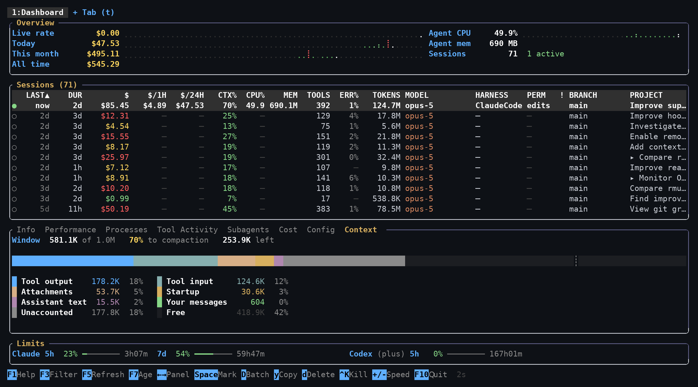

# The bottom panels

[← back to the README](../README.md)

The panel under the table describes whichever session the cursor is on. `←` and
`→` move between panels, `1`–`9` and `0` jump to one, `Tab` cycles through them,
and `Shift+↑`/`↓` scrolls inside the active one.

A few of them repay a closer look, and so does the conversation view `i` opens.

## Tool Activity

Each invocation shows the time, its arguments, and — where the transcript
supports it — what it did:

```
19:16 main    ~/cctop/src/ui/render.rs     +43 -24   122ms ↓498.5K ↑ 1.2K
19:34 ↳aa1b82 ~/cctop/src/quota.rs          +2 -0    88ms ↓ 41.2K ↑  310
19:41✗main    cargo test --all-targets               1.4s  ↓ 12.0K ↑  180
```

- **origin** — `main` for the session itself, or `↳<agent-id>` for a subagent.
  Subagent activity is interleaved into the same log, so without this there's no
  way to tell an agent's edits from the parent's.
- **`✗` and a red row** — the call reported an error. Claude records this per
  call, OpenCode and Gemini record a tool status, Devin's comes from its database
  rather than its transcript, and Codex is read from the sandbox's own result line
  and exit code. Cursor, Pi and Windsurf record no tool outcome at all, so their
  calls are never marked.
- **`+N -M`** — lines added and removed, from the edit result's patch.
  Press `v` to expand the diff inline beneath the row.
- **duration** — wall time from the call being issued to its result arriving.
- **`↓` / `↑`** — tokens in and out for the assistant turn that issued the call.
  Claude only; Codex transcripts don't tie token counts to individual calls.

That last one deserves a caveat: **billing is per API request, not per tool
call.** When one turn issues several calls they all show that turn's figures,
marked with a leading `*`. Dividing the total between them would invent
precision the transcript doesn't contain. `↓` includes cache reads, which is why
it tracks total context size rather than the size of any one call.

Codex tools are decoded too: `apply_patch` shows the files it touched and its
line counts, `update_plan` shows progress and the step in flight, and
`write_stdin` distinguishes a real write from a poll for more output.

## Reading the conversation

The panels summarise what a session did; `i` shows what it said — or `Enter`
and **Read the conversation**. It opens the selected row's transcript
full-screen, a remote row's too (read over the same ssh link), at the end, so
the agent's last reply is the first thing on screen. It reads what `cctop
serve`'s conversation page reads, so every harness that page shows is here, for
the times you are on ssh with no browser to open.

- **Each turn is headed by who spoke and when**: you in the accent colour, the
  agent in its harness's, with the local time (and the date, for an older turn)
  and how long ago. What you typed sits behind a bar in that same colour, so a
  prompt is easy to find in a page of replies. Thinking is dim and italic; a
  compaction is a rule across the page.
- **Replies are rendered as markdown**: headings, bold and italic, inline code,
  fenced blocks on a shaded ground with their language named, lists, quotes,
  tables and rules. Links are OSC 8 hyperlinks, so a click opens them even when
  they wrap; on a terminal that cannot do that (`TERM=dumb` or `linux`) the URL
  is printed after its label. What you typed is shown as you typed it. Code is
  not syntax-highlighted.
- **A subagent's call is one line too**, naming the agent and how much it did
  (`3 turns · 12 tools · 2m10s`); opened, it shows the agent's report. A
  background agent that never handed back shows its last message instead,
  labelled as that. `a` opens the agent's own turns, and `Esc` comes back to
  the same place; opening the reader on a subagent's row in the table goes
  straight to its turns.
- **Tool calls are one line each** until you open them: the tool, its argument,
  and how many lines opening it would add. `Enter` opens the calls of the turn
  you are reading; `t` opens every one.
- **Tool output keeps its colours.** cargo's green, pytest's red and git's diff
  colours come through, folded to sixteen colours on a terminal that has only
  those and dropped under `NO_COLOR`. Anything else a program wrote — cursor
  moves, line erases, window titles — is removed, so it cannot scribble over the
  view. Expanded Tool Activity rows get the same treatment.

A session paged back far with `u` can run to thousands of turns. It is laid
out once for the terminal's width, and scrolling it lays nothing out again.

| Key | In the conversation |
|---|---|
| `↑` `↓` / `j` `k` | Scroll a line (the wheel scrolls three) |
| `PgUp` `PgDn` / `b` `Space` | Scroll a page |
| `Ctrl+U` `Ctrl+D` | Half a page |
| `g` `G` / `Home` `End` | The start / the end |
| `[` / `]` | Previous / next turn, header at the top |
| `/` | Search as you type; `Enter` keeps it, `Esc` goes back to where you were |
| `n` / `N` | Next / previous match (wraps) |
| `Enter` or `x` | Open or fold the tool calls of the turn at the top |
| `t` | Open or fold every tool call |
| `m` | Toggle between rendered markdown and its source |
| `u` | Load earlier turns, when there are any |
| `a` | Open the subagent whose call is highest on screen: its own turns, titled with the agent and its session |
| `Esc` | Clear the search; with none, back out of a subagent's turns, or close |
| `q` | Close |

## Context breakdown



`CTX%` says the window is 68% full. The **Context** panel says what is in it —
Claude sessions only, since no other provider's transcript reports per-request
usage.

```
Window   181.4K of 200K

Unaccounted    ━━━━━━━━━━━━━━━━────────────────────────   62.1K  34%
Tool output    ━━━━━━━━━━━━────────────────────────────   43.5K  24%
Startup        ━━━━━━━━━───────────────────────────────   34.5K  19%
Tool input     ━━━━━━━━────────────────────────────────   29.0K  16%
Attachments    ━━━━────────────────────────────────────    9.1K   5%
Assistant text ━━──────────────────────────────────────    3.6K   2%
```

Two of those numbers are measured and the rest are estimated, and the panel
never blurs the line:

- **Window** and **Startup** come from the usage figures the API itself
  reported. Startup is the first request of the live segment — everything the
  harness sends before the conversation begins: the system prompt, the tool
  schemas, CLAUDE.md, the skills index, and, after a compaction, the summary. It
  cannot be split further, because the transcript never records what was sent,
  only that it was.
- **Tool output**, **Tool input**, **Attachments**, **Your messages** and
  **Assistant text** are estimated from how many characters the transcript
  holds, at 2.75 characters per token. That constant is fitted rather than
  assumed: across 167 local sessions, the characters a transcript accumulates
  divided by the context growth the API reports over the same span lands there,
  well under the usual prose rule of thumb because this content is mostly code,
  JSON and file paths.
- **Unaccounted** is the remainder, and it is deliberately a bar of its own
  rather than being spread across the categories that happen to be measurable.
  It runs around a third of the window. Most of it is thinking — Claude Code
  writes those blocks with the text stripped and only the signature left, so
  there is nothing to measure — plus the `<system-reminder>` text the harness
  splices into each turn without recording it, plus estimation error.

A compaction resets the whole thing: everything before the summary has left the
window, so counting across one would describe a context that no longer exists.
Subagent turns are excluded too — they run against their own windows, and only
the report a subagent hands back is in the parent's, where it lands in **Tool
output** like any other result.

When the estimate overshoots the window there is no gap to draw, and the panel
says so instead of clamping: it means the harness has dropped context that the
transcript still holds.

Given the height, the bar folds into a **block map**, like a memory map of the
window: the same cells in the same order, filling rows left to right and top to
bottom, a quarter of the panel's rows and up to six. One row of eighty cells
spends 2.5K of a 200K window per cell; four rows spend 625 tokens, which is the
difference between a small category showing and vanishing. The footnote says
what a cell is worth. Every category in the window gets at least one cell
however small its share, so nothing in the legend is missing from the map. On
the map, the free space past the auto-compaction threshold is drawn as `·`
rather than a lone `┊`, because that is a region — room the harness reclaims
before it is ever reached — and one marker cell is lost in a grid. A panel too
short to spare the rows keeps the one-row bar.

Under the bar, **How it filled** charts the window across every request the
session made. The bar answers "what is in there"; the chart answers "how did it
get that full", which is the part that changes what you do next. A window that
climbed evenly is a conversation that grew and will keep growing. One that
stepped is a handful of large tool results, and the same call will do it again.
A sawtooth is a session living on compactions, paying to rebuild its context
over and over. The chart spans the whole session rather than the live segment,
because a compaction is the most interesting thing that can happen to a context
window and it is the only view that can show one.

## Preview

Panel `9`, Preview, is the selected row's tab, watched from the dashboard: the
agent's screen as it is right now, updating while you look, without leaving the
table to see whether it has finished or is asking you something.

It is a window, not a way in. Nothing typed on the dashboard reaches the agent,
and the pane is not resized to fit the panel — the agent keeps drawing at the
size its tab gave it, and the panel shows as much of that as fits. When the
screen is taller than the panel, the bottom of what the agent has drawn is what
stays, because that is where its prompt and its questions are. The bottom border
names the tab and the key that goes to it, `Alt+2` onwards.

A tab you have switched away from gives up its rmux client, so there is no
screen of cctop's own to show. The panel asks rmux for the screen instead, twice
a second and only while the panel is on show; that is a read, and rmux resizes
nothing for it.

A row with no tab says so in one line: `a` opens a running session's terminal in
one, `R` resumes a stopped session in one, and either then shows here live. A
row from [another machine](integrations.md#more-than-one-machine) has no tab
here to show.

## Changes

The last panel, `0`, is what the session did to its repository: the files
changed in its working directory's checkout since it started, with their line
counts, and the diff of any one of them. It is the review you would otherwise
leave cctop for.

```
Since 3f2a91c, HEAD when the session started
3 files  +14 −3   [ ] pick a file, v opens its diff, p a pull request
▾ src/app.rs             +12 −3
    @@ -1,3 +1,4 @@
     fn main() {
    -    run();
    +    run_with(args());
    +    log();
▸ assets/logo.png binary
▸ notes.md           new  +2 −0
```

`[` and `]` move between files, `v` opens or closes the one the cursor is on,
and a click on a row does both. The keys are Tool Activity's: there they move
through its list and show diffs too.

**The base is where `HEAD` was when the session started**, read from the
checkout's reflog, and the first line names it. The diff runs from there to the
working tree, so it holds the commits the agent made and what it left
uncommitted alike, whichever branch it is on. The other candidate, the
merge-base with the default branch, is right only for an agent on a branch of its
own: on `main` there is no merge-base worth the name, and an agent handed
someone else's branch would be charged with all of it. When the reflog cannot
say, the first line says what stood in:

- **where this checkout was made** — a worktree created after the session
  started, usually by the agent for itself;
- **the last commit before the session started** — a checkout with no reflog;
- **nothing** — a repository with no commit from before the session, so every
  file is new;
- **HEAD** — a session whose start is not known, so only uncommitted changes.

Untracked files the ignore rules let through are listed as `new`: an agent's new
file is often its most important change, and `git diff` never shows one that was
not added.

It is the checkout's diff, not the agent's: a person editing the same checkout
during the session, or another agent working in it, shows up here too. Tool
Activity has the agent's own edits, call by call.

It is read off the drawing thread, only while the panel is on show, and again
whenever the session does something. Big changes are bounded rather than
waited for: 300 files, 1 MiB of patch and 400 lines of any one file's diff, each
with a line saying what was cut. A session in a directory outside any repository
says so, and so does a row from [another
machine](integrations.md#more-than-one-machine), whose checkout is there and not
here.

### Landing it as a pull request

When the work is committed, `p` pushes the session's branch to `origin` and
opens a GitHub pull request for it with [`gh`](https://cli.github.com). It is
the step after `F`: fork a worktree, let the agent work and commit, read the
diff here, then `p`. The row menu (`Enter`) has it too.

Each step is said on the status line as it happens — checking the branch,
checking `gh`, looking for an open pull request, pushing, opening — and all of
it runs off the drawing thread. Before anything is pushed a box shows the
branch, the base it goes into, how many commits and files, and the title, which
you can edit:

```
╭ Pull request ────────────────────────────────────────────────╮
│ fix-login → main   2 commits, 1 file                         │
│ Pushed to origin, then opened with gh. The body lists the    │
│ commits and files — nothing from the conversation.           │
│                                                              │
│ > Fix the login hint█                                        │
│                                                              │
│ 3 files left out, uncommitted.                               │
│ Enter push and open   Esc cancel                             │
╰──────────────────────────────────────────────────────────────╯
```

The title starts as the session's own title, or the commit's subject when there
is one commit, or the branch name made readable. The body lists the commits and
the files they change against the base. It never quotes the conversation: a
prompt is private and a pull request may be public.

It says no, and why, when the session is not in a git repository, is on a
detached `HEAD` or on the default branch (`origin/HEAD`, else `main` or
`master`), has no commits the default branch lacks, has no `origin`, or when
`gh` is missing or not logged in (`gh auth login`). It also refuses a row from
another machine, another user's session, and a subagent.

**Uncommitted work is asked about, not committed.** If `git status` shows
anything, you are asked first — `3 files uncommitted — they are not in the pull
request` — and `y` goes on without them. An agent's checkout nearly always has
something loose in it that does not belong in the pull request, so a refusal
would only send you off to tidy up. Committing them for you would put work in
the pull request that nobody chose.

If the branch already has an open pull request, the box shows its URL instead
of a title, and `Enter` only pushes to it. Either way the pull request's URL
ends up on the clipboard.

It never force-pushes and never merges. A push that the remote turns down
because its branch has moved on is reported with git's reason, and nothing more
is tried. Nothing it runs can prompt: git and `gh` run with their prompts off,
with no terminal, and under a deadline.
